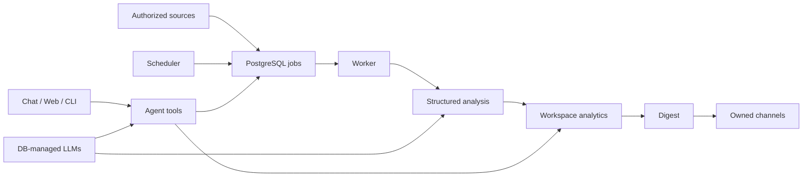

# AI Assistant

An extensible assistant for evidence-backed research and controlled business
workflows. The existing social-media monitoring system is the first domain, not
the product boundary.

The common process is:

**Goal → authorized sources → collect/search → verify → analyze/calculate →
propose → approve when required → deliver/execute → audit/follow-up.**

[Product plan](docs/PRODUCT_PLAN.md) ·
[Project map](docs/PROJECT_MAP.md) ·
[Target architecture](docs/ASSISTANT_ARCHITECTURE.md) ·
[Documentation index](docs/DOCS_INDEX.md)

## Current capabilities

- Telegram, MAX and web agent chat with persistent sessions, memory and feedback.
- VK and Telegram collection through explicitly configured API or user access.
- Reusable analysis scenarios, structured outputs and stored analytics.
- PostgreSQL-backed schedules, jobs, retries and execution outcomes.
- Daily/weekly digests to active workspace-owned Telegram/MAX bindings.
- Shared deployment with isolated workspaces, membership and personal credentials.
- DB-managed OpenAI-compatible and Anthropic providers/models with encrypted keys,
  capability-aware selection, fallback and usage projections.

Important limits:

- [Source audit follow-ups (PR #196)](https://github.com/Starck43/social-media-ai/pull/196) include unsafe legacy password
  recovery, public profile hashes and conditional profile privilege escalation.
  Documentation updates do not fix these runtime paths; do not infer production
  security from the bounded merged packages.

- MAX transport does not imply MAX content collection.
- Raw collected content is staged for analysis, not a permanent archive.
- Current cost fields do not form a complete concurrency-safe billing ledger.
- External publication stays disabled or preview-only until its authorization,
  approval, idempotency and recovery gates are accepted.
- Production readiness is tracked in
  [BUSINESS_PRODUCTION_READINESS](docs/BUSINESS_PRODUCTION_READINESS.md), not
  inferred from this README.

## Product direction

Planned capability areas include authorized web/video research, local-file and
email search, unified customer communication, reminders, CRM/ERP connectors,
deterministic commercial calculations, case history, documents and remote
approval. These are planned modules. Implement one validated workflow at a time
after its foundation gates; see [PRODUCT_PLAN](docs/PRODUCT_PLAN.md).

## Architecture

The active system is a modular Python application using FastAPI, SQLAlchemy,
Alembic and PostgreSQL. `python -m app.runtime` starts the scheduler, worker and
Telegram/MAX long-poll listeners. PostgreSQL owns schedules, jobs, tenant data,
analytics, conversation state and delivery bookkeeping.



- The active runtime does not depend on Celery or Redis; their legacy path is frozen.
- Scenarios define analysis methodology; tasks define execution, sources and targets.
- Interactive access fails closed and all external writes retain explicit policy gates.
- Optional integrations must not prevent startup when they are unconfigured.

See [AGENT](docs/AGENT.md), [AGENT_TASKS](docs/AGENT_TASKS.md),
[COLLECTION](docs/COLLECTION.md), [DIGEST](docs/DIGEST.md) and
[TENANCY](docs/TENANCY.md).

## Quick start

Requirements: Python 3.12+, PostgreSQL 14+ and a reviewed local or Compose setup.

```bash
git clone https://github.com/Starck43/social-media-ai.git
cd social-media-ai
git checkout dev
python -m venv .venv
.venv/bin/python -m pip install -r requirements.txt
cp .env.example .env
```

Set at least `POSTGRES_URL` and `CREDENTIALS_KEY`. Add messenger credentials only
for channels you use. Never commit `.env`, API keys, tokens or user sessions.

```bash
.venv/bin/python -m alembic upgrade head
.venv/bin/python -m app.runtime
```

Optional API/admin process:

```bash
.venv/bin/python -m uvicorn app.main:app
```

The runtime already includes the scheduler, worker and listeners; do not start a
second full runtime accidentally. Configure providers/models through `/admin` and
mark the intended model default. Providers do not carry a default flag. Configure
sources, scenarios, schedules and active workspace delivery bindings through the
supported UI/API/CLI paths.

Setup details: [CONFIGURATION](docs/CONFIGURATION.md),
[DEPLOYMENT](docs/DEPLOYMENT.md), [ADMIN](docs/ADMIN.md), [API](docs/API.md) and
[CLI](docs/CLI.md).

## Development

Read [AGENTS.md](AGENTS.md), `docs/RULES.md` and `docs/COLLABORATION.md` before
work. Use the project virtualenv and assign the narrowest relevant check through the
primary OpenCode test-runner route (secondary: Kilo test-orchestrator → test-runner →
pare-test) in
[Collaboration](docs/COLLABORATION.md#headless-delegation-launches-from-a-task-worktree).
Do not run pytest directly from the coordinating process. If that route is
blocked, follow only the documented fallback; a blocked runner is not a green check.

Database tests share the configured test schema and run sequentially. Schema
create/reset/drop/stamp/migrate operations require explicit owner instruction.
Do not run a broad suite merely for a documentation-only change.

Development reading order:

1. [Product direction](docs/PRODUCT_PLAN.md)
2. [Engineering and release gates](docs/BUSINESS_PRODUCTION_READINESS.md)
3. [Open tasks](ROADMAP.md) and [phase board](docs/phases/README.md)
4. The relevant subsystem document from [DOCS_INDEX](docs/DOCS_INDEX.md)

Delivered foundations are indexed in
[IMPLEMENTATION_STATUS](docs/IMPLEMENTATION_STATUS.md). Exact implementation and
test history remains in Git and pull requests.
