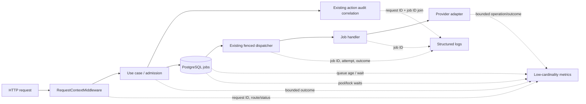

# Capacity and telemetry specification

**Status:** specification accepted 2026-10-31; instrumentation and measurements remain implementation gates. No numeric SLO target or capacity claim is made here.

## Decision summary

First establish a privacy-safe observability contract and a reproducible local
workload. Select numeric SLOs, pool/admission bounds, indexes, and any topology
changes only after collecting a representative baseline in an isolated local
environment. Keep the existing single `python -m app.runtime` owner, PostgreSQL
queue, claim fencing, and deployment topology unchanged.

The existing 15-minute pending and 30-minute stale-running health banners are
operational warning thresholds, not validated latency objectives. Do not turn
them into SLOs without a product freshness requirement and measured baseline.

## Correlation contract

| Identifier | Meaning | Propagation and limits |
| --- | --- | --- |
| HTTP request ID | One inbound HTTP request; use `RequestContextMiddleware`'s validated/generated value. | Include in request/use-case logs and return it in the response header. Bound its length and accepted characters as the middleware already does. |
| Launch idempotency key | `TaskLaunchArguments.request_id`, used to deduplicate one launch. | Keep distinct from the HTTP request ID; never use it as a metrics label or silently overwrite it with a trace identifier. |
| Job ID | One durable queue job and its claim/attempt lifecycle. | Include in enqueue, claim, finish, and retry logs. Use it to join worker evidence to the enqueue audit where available. |
| Agent task ID | Higher-level task associated with a job when present. | Keep in structured logs only; it is not a metric dimension. |

At enqueue, preserve the HTTP origin request ID in the existing audit/correlation
path where that path is available, paired with the resulting job ID. `ActionAuditEvent`
already has optional `request_id` and `job_id`; extend the existing link only if
an enqueue path currently drops it. Do not create a second audit ledger or make
origin-request persistence a prerequisite for correctness. Worker logs must still
be diagnosable by job ID when an origin request ID is absent.

Logs should have a stable structured envelope (`event`, `timestamp`, `request_id`,
`job_id`, `task_id`, `job_type`, `attempt`, `outcome`, `error_code`, and elapsed
time where relevant). IDs are for trace lookup, not metric labels. Exclude
credentials, tokens, provider payloads, prompts, post/message text, and arbitrary
exception bodies. Error classes should use a bounded allowlist; sanitize
untrusted provider and database error text before logging.

## Metrics contract

Instrument the following low-cardinality signals. Names are proposals; keep one
consistent naming and units policy if implementation adopts different project
conventions.

| Signal | Type / unit | Allowed dimensions and notes |
| --- | --- | --- |
| `http_server_request_duration_seconds` | Histogram, seconds | Method, route template, status class. Never raw path, request ID, actor, or tenant. |
| `task_admission_total` | Counter, runs | Bounded outcome and admission class. Separate accepted/rejected reasons. |
| `job_queue_pending` | Gauge, jobs | Bounded `job_type` and status only. |
| `job_queue_oldest_due_age_seconds` | Gauge, seconds | Bounded `job_type`; only due pending jobs. A missing value means no due work, not zero delay. |
| `job_queue_eligible_to_start_seconds` | Histogram, seconds | Bounded `job_type`; measure start minus eligibility time (`max(enqueued_at, run_at)`). Confirm the authoritative enqueue timestamp before implementation; do not substitute a future `run_at` delay for queue wait. |
| `job_run_duration_seconds` | Histogram, seconds | Bounded `job_type` and terminal outcome. Measure `finished_at - started_at`. |
| `job_attempts_total` | Counter, attempts | Bounded `job_type`, outcome, and retryable/non-retryable class. |
| `provider_operation_duration_seconds` | Histogram, seconds | Bounded provider family, operation, and outcome; no account, credential, object, or tenant labels. |
| `provider_budget_remaining` | Gauge, units or requests | Bounded provider family and budget class; never expose secrets or per-account dimensions. |
| `db_pool_acquire_wait_seconds` | Histogram, seconds | Pool/engine role from a bounded configured set. |
| `db_lock_wait_seconds` | Histogram, seconds | Bounded operation class; use sampled/aggregated database evidence where direct per-operation timing is unavailable. |
| `existing_ledger_spend` | Counter/gauge, currency units | Read the authoritative cost ledger and its bounded cost category. Do not create a second billing/accounting source. |

For every metric, forbid labels containing tenant/user/account IDs, request/job/task
IDs, URLs, SQL text, object IDs, provider response values, exception messages,
or other user-controlled strings. Do not emit per-tenant time series. If noisy
neighbor analysis needs tenant attribution, compute it in the isolated test
report from synthetic tenant IDs and discard or aggregate those identifiers
before publishing shared telemetry. A small, explicitly configured plan/admission
class may be a bounded label if it is already part of policy.

## Architecture sketch

This is an instrumentation overlay, not a new runtime component, exporter,
worker, scheduler, listener, queue, or event bus. Preserve the current transaction,
attempt budget, retry/backoff, and claim-fencing semantics.

## SLI/SLO selection

The implementation task should propose numeric targets only after the local
baseline and product freshness needs are available. Evaluate, at minimum:

1. **Admission:** accepted/rejected rates and time to enqueue, split by bounded
   admission class.
2. **Queue:** due-job age and eligible-to-start delay, by bounded job type.
3. **Completion:** successful completion latency, retry rate, terminal failures,
   and claim/recovery outcomes by bounded job type.
4. **Freshness:** time from an eligible collection request to persisted useful
   data, for an agreed representative operation.
5. **Fairness:** whether one synthetic tenant's burst materially degrades
   another tenant under the existing admission limits.
6. **Resources/cost:** DB pool and lock waits, provider budget use, and cost
   from the existing authoritative ledger.

State target, window, population, exclusions, and error budget for every selected
objective. Separate user-visible latency from provider/network latency and
scheduled future wait. Do not infer an objective from a dashboard warning or
from a single run.

## Reproducible local workload

Run only against an isolated local database with synthetic records and mocked
providers/model calls. Never use production credentials, live provider accounts,
public/shared databases, real customer content, or a second runtime owner.

| Scenario | Workload | Evidence |
| --- | --- | --- |
| Baseline | Representative synthetic collect → analyze jobs at a steady rate. | Throughput, p50/p95/p99 queue delay and runtime, errors/retries, DB pool/lock waits, provider-call budget, and sample counts. |
| Burst | Short bounded arrival burst followed by drain. | Peak due backlog, oldest-due age, drain time, rejection behavior, and recovery to baseline. |
| Noisy neighbor | Two or more synthetic tenants; one produces a bounded burst while another submits steady work. | Per-synthetic-tenant admission and completion distributions in the private report, plus aggregate metric cardinality check. Anchor limits to the existing P11-T08 actor/workspace admission caps; do not extrapolate keyed one-off limits to legacy or scheduled paths. |
| Recovery | Stop/restart the local runtime during a claimed job; allow normal lease/claim recovery. | No duplicate successful effect, no lost claim fence, retry/terminal behavior, and queue drain after restart. Use idempotent local fakes. |
| Resource pressure | Vary only documented local pool/workload settings, one factor at a time. | Pool wait, lock wait, throughput and latency changes; do not prescribe a production pool size from this experiment. |

For each run, record repository commit, Python and PostgreSQL versions, host
CPU/memory, database settings, runtime and pool configuration, workload mix,
arrival rate, concurrency, deterministic seed, exact commands, run duration,
warm-up, sample count, and output format. Repeat each condition enough to expose
variance; report p50/p95/p99 with sample counts and errors, not just averages.
Keep raw synthetic tenant identifiers local to the report and remove them from
shared metrics/logs. Capacity statements must identify the tested configuration
and remain limited to that environment.

## Acceptance gate for an implementation task

- Correlation fields are propagated without conflating HTTP request IDs and
  idempotency keys; enqueue and worker events can be joined when the existing
  audit path supports it.
- Metrics use bounded labels only; a test or review verifies that identifiers,
  payload text, and exception text cannot become dimensions.
- Queue wait, execution time, pool/lock wait, and provider budget are measured
  with documented definitions and missing-data behavior.
- Synthetic baseline, burst, noisy-neighbor, and recovery scenarios are
  reproducible, with configuration and p50/p95/p99/sample counts recorded.
- Numeric targets and resource bounds are proposed from the evidence and
  product freshness requirements, then reviewed separately.
- Any topology, pool, index, or admission-policy change is a separate measured
  decision. No extra worker/scheduler/listener is introduced by this spec.

## Documents and source contracts

- [P11-T19 acceptance and limitations](audit/p11-t19.md)
- [P11-T03 accepted queue and runtime ownership](audit/p11-t03.md)
- [P11-T12 accepted action-audit contract](audit/p11-t12.md)
- [P11-T08 accepted task-launch admission limits](audit/p11-t08.md)
- [Queue and claim lifecycle](AGENT_TASKS_QUEUE.md#how-a-run-happens)
- [Operational visibility and support](BUSINESS_PRODUCTION_READINESS.md#prd-08--operational-visibility-and-support)
- [Expansion sequence and scale gates](PRODUCT_PLAN.md#expansion-sequence)
