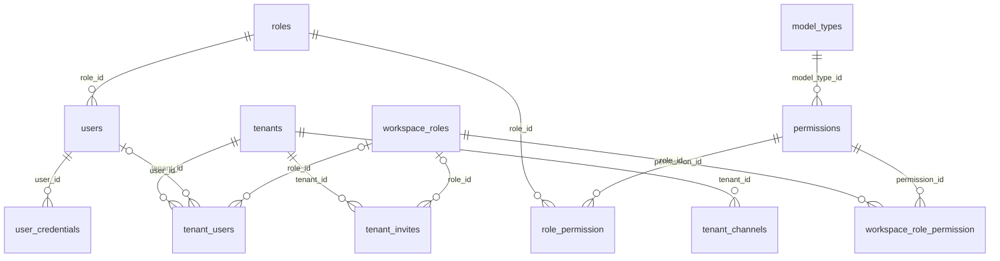
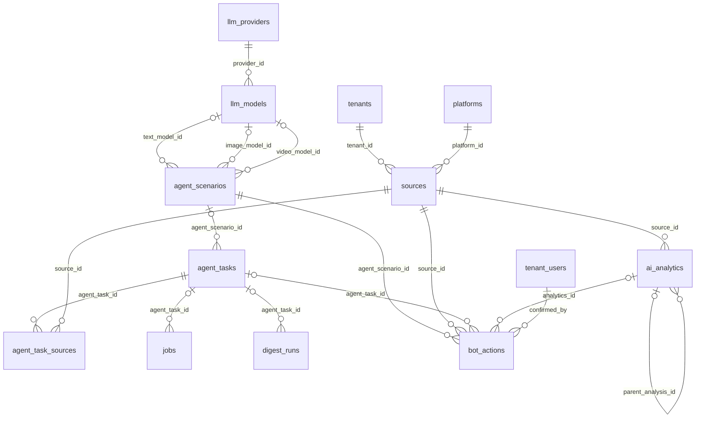
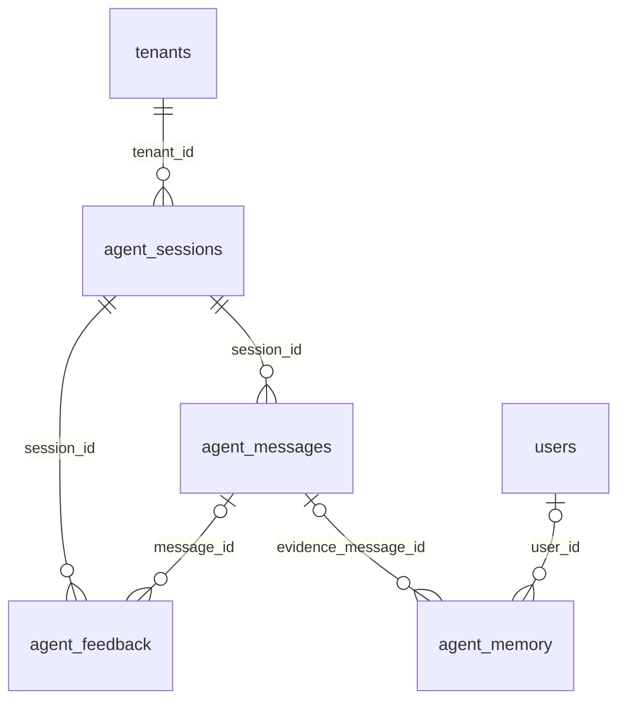
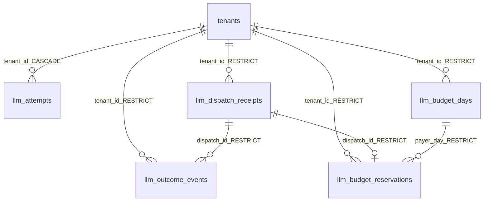

# Data Model Reference

Reconciled on 2026-10-15 against source `dev`
`edbe0fc02e6ea2d78302129e51febfa0e87464ab` (the task reservation commit
`916d2e18eeafdd86d4857587638b73a24bcd0891` changes only the ownership board).
The source-declared Alembic head is **0096**. This reference describes ORM and
migration definitions, not the revision or integrity of a running database.
No application import, database inspection or migration was run for this update.
Schema comes from `settings.DB_SCHEMA`; never hardcode it in application code.

The public facade is [app.models](../app/models/__init__.py); canonical definitions
live in domain packages. [bootstrap](../app/models/bootstrap.py) binds managers
once after class registration. Root-level modules and the older `analysis.llm_*`
/ `scheduling.digest_run` modules are compatibility re-exports of the same mapped
classes, not additional tables. `Role` aliases `PlatformRole`; it is not another
mapper. See [access transition](ACCESS_MIGRATION.md) and [tenancy](TENANCY.md).

Field inventories omit inherited fields where indicated. Exact types, defaults,
nullability and constraints remain in the linked declarations. Planned work and
PR branches are not current schema: see [delivered evidence](IMPLEMENTATION_STATUS.md)
and the [ownership board](design/README.md). Merge, migration application, runtime
activation and whole-gate acceptance are distinct states.

### Table inventory

The source defines **31 mapped tables and 3 association tables**:

| Domain | Mapped tables | Association tables |
| --- | --- | --- |
| Identity | `users`, `roles`, `permissions`, `model_types`, `user_credentials` | `role_permission` |
| Tenancy | `tenants`, `tenant_users`, `tenant_invites`, `tenant_channels`, `workspace_roles` | `workspace_role_permission` |
| Collection | `platforms`, `sources`, `collected_items` | — |
| Analysis | `agent_scenarios`, `ai_analytics` | — |
| LLM | `llm_providers`, `llm_models`, `llm_attempts`, `llm_dispatch_receipts`, `llm_outcome_events`, `llm_budget_days`, `llm_budget_reservations` | — |
| Scheduling | `agent_tasks`, `jobs`, `bot_actions` | `agent_task_sources` |
| Notifications | `notifications`, `digest_runs` | — |
| Agent | `agent_sessions`, `agent_messages`, `agent_memory`, `agent_feedback` | — |

## Base classes and isolation boundaries

[Source: base.py](../app/models/base.py), [BaseManager](../app/models/managers/base_manager.py).

- `Base` supplies schema-aware metadata and a class-level manager placeholder. It does not define generic instance `save()`/`delete()` methods; specialized models may define their own methods.
- `TimestampMixin` supplies non-null `created_at` and `updated_at`, `DateTime(timezone=True)`, server default `now()`; `updated_at` also has SQLAlchemy `onupdate=now()`.
- `TenantScopedMixin` supplies non-null `tenant_id` FK → `tenants.id`, `ON DELETE CASCADE`, and the `__tenant_scoped__` marker. It does not itself enforce query authorization.
- Normal BaseManager querysets apply tenant criteria and fail without context for marked models; create rejects mismatched tenants. Explicit bypass, caller-built/raw SQL and association helpers require separate authorization. This is not automatic PostgreSQL row-level security or a guarantee that every direct SQL path is safe.
- `Tenant`, `TenantUser`, `TenantInvite`, `TenantChannel` do not inherit the marker, even though the latter three contain workspace FKs. Their managers/callers must enforce ownership explicitly. The tenant row itself has no `tenant_id`.

## Global catalog and identity tables

Timestamp fields apply to the catalog/identity models below except `platforms`.
Association tables have no timestamps. LLM evidence/budget timestamp exceptions
are stated in their own section.

### `platforms`

[Source](../app/models/collection/platform.py). Fields: `id` PK; `name` String(50), unique/non-null; `platform_type` native enum; `base_url` String(255), non-null; `params` JSON, non-null, default dict; `is_active` nullable Boolean, default true. No rate-limit columns, `created_at` or `updated_at` are declared. Reverse relationship: `sources`.

### `roles`

[Source](../app/models/identity/role.py). ORM `PlatformRole` (temporary import alias `Role`), physical table `roles`: `id` PK; unique checked string `codename` (`user`, `operator`, `admin`); nullable text `description`. No duplicate `name`. User assignments and `role_permission` remain platform-only.

### `role_permission`

[Source](../app/models/identity/role.py). Composite PK (`role_id`, `permission_id`), both FK columns to roles/permissions. No timestamps or tenant column. Association updates are not tenant-scoped queryset operations.

### `workspace_roles` and `workspace_role_permission`

[Source](../app/models/tenancy/workspace_role.py). Independent role catalog with timestamps: `id` PK; unique checked `codename` (`owner`, `admin`, `manager`, `analyst`, `viewer`); nullable text `description`. The association has composite PK (`role_id`, `permission_id`) referencing workspace roles and permissions. Effective workspace grants use the fixed catalog presets.

### `model_types`

[Source](../app/models/identity/model_type.py). Application model metadata, NOT the LLM capability enum. Fields: `id` PK; unique/non-null `resource_key` String(100); non-null `model_name` and `table_name` String(100) (neither is declared unique in the ORM); `description` nullable Text; `is_managed` Boolean, default true. Reverse relationship: permissions.

### `permissions`

[Source](../app/models/identity/permission.py). Fields: `id` PK; `name` non-null text label; `action_type` native action enum; `model_type_id` FK to resource metadata. Unique (`model_type_id`, `action_type`). No stored `description` column. `codename` is a computed property (`resource_key.action`), not a stored column. Exact registered keys and explicit one-release legacy aliases resolve through the shared catalog.

### `users`

[Source](../app/models/identity/user.py). Fields: `id` PK; `username` String(50) and `email` String(100), each unique/indexed/non-null; `hashed_password` String(255); `is_active` Boolean; non-null `role_id` FK → roles. No `is_superuser` column or `notifications` relationship is declared on User. Platform operator identity and workspace membership are separate concepts.

### `llm_providers`

[Source](../app/models/llm/llm_provider.py). Fields: `id` PK; `name` String(255), unique/non-null; `description` nullable Text; `api_format` String(20), non-null/default `openai`; `base_url` String(500), non-null; `auth_header` nullable String(200); `encrypted_api_key` nullable Text; `is_active` Boolean. Relationship: models. No `is_default` column. Secret accessor is **`get_api_key()`**, masked display `decrypted_key_masked()`; never log plaintext. Global fleet; no tenant override or private-device route in this table.

### `llm_models`

[Source](../app/models/llm/llm_model.py).

| Column group | Declaration / meaning |
| --- | --- |
| `id`, `provider_id` | Integer PK; non-null indexed provider FK, CASCADE |
| `name`, `model_id`, `description` | String(100), String(100), nullable Text |
| `model_type` | String(20), default text; `capabilities` is computed by splitting commas, not a column/native capability enum |
| `custom_endpoint_path` | Nullable **String(200)**, added by 0086 |
| `input_cost_per_1k`, `output_cost_per_1k` | Non-null Float, default 0; configured USD per 1K tokens |
| `last_request_cost`, `last_request_cost_at` | Nullable Float and timezone-unspecified DateTime |
| `last_used_at`, `last_success_at`, `last_error_at` | Nullable timezone-unspecified DateTime |
| `use_count`, `fail_count` | Non-null Integer, default/server default 0 |
| `max_tokens`, `default_temperature` | Non-null Integer default 4096; Float default 0.3 |
| `is_active`, `is_default` | Boolean defaults true/false |

Relationships: provider and text/image/video scenario model references. Only models carry the default flag; migration 0091 removed the provider-level flag. `LLMModelManager.set_default()` clears overlapping defaults per capability. Standard/quality resolution prefers that flag, cost-efficient resolution sorts by combined tariff first, and multimodal resolution prefers broader capabilities within the default rank; all exclude inactive providers. These are application invariants, not database unique constraints. API-supported formats/capabilities and fallback behavior are client/schema contracts, not validated merely by these String columns. Do not assume API compatibility means tenant-private/local model routing is implemented.

The SQLAdmin model editor exposes configuration fields only; cost/usage/history
telemetry is read-only in details. The short model check is the shared local
`probe_short()` service used by web settings and admin, not a provider-health or
accounting acceptance test. See [admin testing modes and price display](ADMIN.md#llm-testing-and-prices)
for the separate short/mock/explicit paid-probe contracts. This changes no ORM
columns or migrations.

## Workspace and personal credential tables

All tables in this section have TimestampMixin. The tables are not marked with TenantScopedMixin.

### `tenants`

[Source](../app/models/tenancy/tenant.py). Fields: `id`, `name` String(100), unique `slug` String(50), `plan` **String(20), default `pro`**, `timezone` String(50), `is_active`, `daily_cost_limit` Float(default 5), `max_sources` Integer(default 20), nullable `agent_style` JSON, `agent_model` String(100), `agent_max_tokens` Integer(default 1024), `agent_temperature` Float(default 0.3), `agent_system_prompt` Text.

Declared CHECK allows **starter/pro/business**; `personal` is historical, migrated in 0071. `PLAN_LIMITS` is a class-level policy, not a table. `effective_limits()` takes min(column override, finite tier ceiling); unlimited business ceilings ignore those column overrides. Source budgets/features/retention policy declarations do not demonstrate complete spend accounting or cleanup.

### `tenant_users`

[Source](../app/models/tenancy/tenant_user.py). Fields: `id`; non-null `tenant_id` FK CASCADE; `channel` String(20) (includes web membership); `external_user_id` String(100); nullable `user_id` FK → users CASCADE; nullable `role_id` FK → workspace_roles SET NULL; `is_active`; `ai_chat_enabled` Boolean, default false. Unique (`tenant_id`, `channel`, `external_user_id`); PostgreSQL partial unique index (`tenant_id`, `user_id`) where user_id IS NOT NULL. Only the explicit `owner` role grants ownership; NULL or unknown roles fail closed.

### `tenant_invites`

[Source](../app/models/tenancy/tenant_invite.py). **Workspace-owned**, not an unowned global invite. Fields: `id`; non-null `tenant_id` FK CASCADE; unique `code_hash` String(64); nullable `role_id` FK → workspace_roles SET NULL; nullable `expires_at` timezone-aware DateTime; `max_uses` Integer(default 1), `used_count` Integer(default 0), `is_active` Boolean(default true).

### `tenant_channels`

[Source](../app/models/tenancy/tenant_channel.py). Fields: `id`, non-null `tenant_id` FK CASCADE; `channel` String(20), `chat_id` String(100), `kind` String(20, default private); Boolean `is_digest_target` default false and `is_active` default true. Unique **(`channel`, `chat_id`)** globally; the same chat is not bound independently to multiple workspaces.

### `user_credentials`

[Source](../app/models/identity/user_credential.py). Personal vault: `id`; non-null `user_id` FK → users CASCADE; `platform`, `kind` String(30); nullable `label` String(100); non-null `secret_encrypted` Text; nullable `expires_at` timezone-aware DateTime and `meta` JSON; `is_active` default true. Indexes on user_id and (user_id, platform). No tenant_id. Membership/owner resolution is required before workspace use; global storage is not unrestricted shared access. `reveal()` decrypts the secret; deployment/application secrets stay in configuration.

## Tenant-scoped collection and analysis

Collection and analysis tables below inherit tenant_id and timestamps. LLM
evidence/budget tables have the separate timestamp and deletion rules below.

### `sources`

[Source](../app/models/collection/source.py). Fields: `id`; non-null `platform_id` FK CASCADE; `name` String(255); native `source_type` enum; `external_id` String(100); `params` JSON; `is_active`; nullable `last_checked` timezone-aware DateTime and `last_item_id` String(100).

Unique **(`tenant_id`, `platform_id`, `external_id`)**. There is **no `user_id` or scenario FK**. Token owner selection uses params/personal-vault resolution, not a nonexistent owner column. Relationships: platform, tenant, analytics; tasks through association table. Task selects scenario, with workspace default for taskless runs.

### `collected_items`

[Source](../app/models/collection/collected_item.py). Fields: `id`; nullable `run_id` Integer; non-null `source_id` Integer; nullable `external_id` String(255); non-null `content_hash` String(64); nullable `platform` String(50), `published_at` timezone-aware DateTime, `media_type` String(20), `text` Text, `metrics`/`author` JSON, `permalink` String(500); nullable `attachments` JSON snapshot added by 0089; non-null `analyze_attempts` default 0 and `give_up_after_attempts` default 3. For attachments, NULL means legacy/unknown and `[]` means explicitly none; snapshots contain only normalized allowlisted fields, not provider payloads or credentials.

**source_id and run_id are logical references, NOT declared FKs.** Unique non-partial index (`source_id`, `external_id`); multiple NULL external IDs remain legal in PostgreSQL. Other indexes: tenant, source/hash, run, source/published. A failed analysis is not evidence that raw content can be deleted; actual retention/cleanup belongs to runtime policy.

### `agent_scenarios`

[Source](../app/models/analysis/agent_scenario.py). Fields: `id`, `name` String(255); nullable `description`, `base_prompt`, `summary_prompt` Text; nullable `content_types`, `analysis_types`, `scope`, `media_overrides`, `output_schema` JSON; nullable `max_tokens` Integer; `is_active` Boolean; non-null `is_default` Boolean default false; nullable `text_llm_model_id`, `image_llm_model_id`, `video_llm_model_id` FKs SET NULL; nullable native `llm_strategy` enum. `ai_prompt` is a compatibility property, not a column.

Methodology belongs here; schedule, source selection, triggers and approval guards belong to tasks. `analyze_type` was removed in 0083; do not draw a direct Source→Scenario FK. Query grouping is not a stored scenario field.

### `ai_analytics`

[Source](../app/models/analysis/ai_analytics.py). Fields: `id`; non-null `source_id` FK CASCADE; nullable `analysis_date` **Date**; non-null native `period_type` enum; nullable `content_hash` String(64); nullable `topic_chain_id` String(100), `chain_label`/`normalized_label` String(255); nullable `parent_analysis_id` self-FK SET NULL; non-null `summary_data` JSON; nullable `response_payload`, `main_topics`, `media_types` JSON; nullable `prompt_text` Text, `llm_model`/`provider_type` String(100), `request_tokens`/`response_tokens` Integer, `estimated_cost` Numeric(14,6).

Cost unit is **USD cents**, unlike USD Float columns elsewhere. NULL cost does not prove zero spend. Unique (`source_id`, `analysis_date`, `period_type`); indexed source, date, chain, source/hash and tenant. No provider_type index is declared here. LLM/model strings are historical attribution, not provider/model FKs. Relationships: source and parent/children.

## Tenant-scoped LLM accounting and admission storage

These five tables inherit the tenant-scoped marker, **not TimestampMixin**.
`llm_attempts`, receipts and outcome events declare only server-created
`created_at`; neither budget table declares timestamps. Receipts, outcome events
and both budget tables override the inherited payer FK to **RESTRICT**.
`llm_attempts` retains the inherited **CASCADE** payer FK. None of these tables
has a registered SQLAdmin model view; ORM registration is not admin exposure.

### `llm_attempts` — captured attempt journal

[Source](../app/models/llm/llm_attempt.py),
[manager](../app/models/managers/llm_attempt_manager.py),
[migration 0092](../migrations/versions/0092_add_llm_attempt_journal.py).

Fields: `id` PK; globally unique/non-null `attempt_key` String(64); non-null
`purpose`, `stage`, `cost_certainty`, `outcome` String(32); nullable plain Integer
`source_id`, `job_id`, `agent_task_id`, `llm_model_row_id`; nullable Date
`analysis_date`; nullable `model_id`, `provider_name` String(200); nullable
Numeric(18,8) tariff snapshots `input_cost_per_1k`, `output_cost_per_1k`; nullable
Integer `prompt_tokens`, `completion_tokens`; nullable Numeric(18,9) **Decimal USD**
`cost_usd`; timezone-aware non-null server `created_at`. Indexes: tenant,
(source_id, analysis_date), job. No source/job/task/model FKs or `updated_at`.

Captured analyzer stages, fallback chat attempts, digest summaries and the agent
model-test tool use this journal. Admin connection/model probes are a separate
unresolved payer/accounting boundary, not evidence of all-path capture. Unknown
usage/tariff stays explicit; NULL cost is never silently free or zero. The
specialized `record_attempt()` acknowledges an owned committed insert or an exact
payer-bound replay; conflicting evidence raises. Its insert-only contract is
**not a migration-installed immutability trigger**: 0092 installs none, and its
downgrade drops the journal. Do not infer the stronger 0093–0095 storage guards
or safe automatic rollback from this journal's name. See
[accounting scope and evidence](IMPLEMENTATION_STATUS.md).

### `llm_dispatch_receipts` — storage merged, runtime unwired

[Source](../app/models/llm/llm_dispatch_receipt.py); migration
definition 0093 follows 0092. This is preparation evidence, not a paid attempt,
provider outcome or HTTP authorization. The reservation manager can persist a
receipt atomically with a reservation, but paid clients are not wired to require
that admission.

Fields: `id`; explicit `tenant_id` FK **RESTRICT**; unique raw `dispatch_id`
String(32); `purpose`/`stage` String(32); timezone-aware `prepared_at` and its UTC
`utc_day`; non-null Integer `llm_model_row_id`, `llm_provider_row_id` plus non-null
`model_id`, `provider_name` String(200); nullable Decimal USD
`input_cost_per_1k`, `output_cost_per_1k` Numeric(18,8); `tariff_state` (`known`, `free`, `undefined`)
and `pricing_policy_version`; nullable plain `source_id`, `job_id`,
`agent_task_id`, `agent_session_id`; server-created timezone-aware `created_at`.
Execution/model references have no foreign keys. No prompt, secrets, cost,
reservation or outcome columns exist. Invalid rates remain NULL, not zero.

The definition contains UPDATE/DELETE/TRUNCATE rejection triggers and a
tenant/day index. Model metadata alone does not install those triggers. Payer
deletion may be blocked; ordinary downgrade refuses evidence deletion, even
when empty. Schema application, offboarding and evidence-preserving rollback
need separate review/approval. See the
[storage boundary](AI_PIPELINE_AND_PROMPTS.md#preparation-receipt-storage-foundation-not-activated).

### `llm_outcome_events` — storage merged, runtime unwired

[Source](../app/models/llm/llm_outcome_event.py); migration definition 0094
follows 0093. Append-only observations/reconciliations reference a preparation
receipt; they are not a settlement, dispatch authorization or aggregate spend.
Several events may describe one attempt: **never sum their costs as independent
attempts**.

Fields: `id`; explicit `tenant_id` FK RESTRICT; globally unique `event_id`
String(32); `dispatch_id` FK to the receipt's unique identity, RESTRICT;
`event_kind`, timezone-aware `observed_at`, `dispatch_state`, `outcome`; nullable
Integer `prompt_tokens`, `completion_tokens`; `provider_price_state`, nullable decimal-only
`provider_cost_raw` String(128), nullable Decimal USD `cost_usd` Numeric(18,9);
`cost_certainty`, `price_source`, `pricing_policy_version`; server `created_at`.
No prompt, credentials, raw provider response or mutable model reference is kept.

The definition rejects UPDATE/DELETE/TRUNCATE. An insert trigger binds payer,
policy and observation time to the receipt, verifies resolved provider amount
consistency and refuses a free tariff unless both frozen rates are explicitly
zero. The manager also recomputes all pricing from the persisted receipt and
requires the enabled receipt/event guards. Metadata bootstrap lacks those guards
and is not approved. Direct SQL is not an alternative pricing API.

Existing isolated/owner-local validation is attributed in
[IMPLEMENTATION_STATUS](IMPLEMENTATION_STATUS.md); this update did not repeat it.
Application to another target, retention/offboarding and rollout require separate
review/approval. Ordinary downgrade refuses deletion. Both the
event and parent receipt block tenant deletion when retained. See the
[outcome boundary](AI_PIPELINE_AND_PROMPTS.md#immutable-outcome-event-storage-foundation-not-activated).

### `llm_budget_days` — reviewed balance foundation, runtime unwired

[Source](../app/models/llm/llm_budget.py),
[migration 0095](../migrations/versions/0095_add_llm_budget_reservations.py).
Fields: `id` PK; explicit non-null `tenant_id` FK RESTRICT; non-null Date `utc_day`;
non-null Numeric(18,9) **Decimal USD** `settled_usd`, `reserved_usd`; non-null
Integer `undefined_count`, `unbounded_count`; non-null Boolean `frozen`
default/server default true; non-null `baseline_version` String(64). No timestamps.
Unique (`tenant_id`, `utc_day`); CHECKs bound nonnegative amounts and counts.
There are no zero defaults for balances/counts: a reviewed baseline is required.
The merged manager does not provision daily baselines or refund at expiry/day
rollover. Draft work such as PR #197 is not part of this source baseline.

### `llm_budget_reservations` — receipt-bound storage, runtime unwired

[Source](../app/models/llm/llm_budget.py),
[manager](../app/models/managers/llm_budget_manager.py),
[migration 0095](../migrations/versions/0095_add_llm_budget_reservations.py).
Fields: `id` PK; non-null `tenant_id` FK RESTRICT; non-null Date `utc_day`;
globally unique/non-null `dispatch_id` String(32), FK to receipt identity RESTRICT;
non-null `ceiling_state` String(16), `undefined_policy_version` String(32);
nullable Numeric(18,9) **Decimal USD** `ceiling_usd`, `cap_usd`; nullable
`bound_version` String(64). No timestamps. Composite FK (`tenant_id`, `utc_day`)
references the payer/day unique key with RESTRICT. CHECKs enforce identity,
`bounded`/`unbounded`/`undefined` state, amount/cap consistency and policy version.

0095 defines UPDATE/DELETE/TRUNCATE rejection and receipt-binding INSERT guards.
`reserve_receipt()` requires installed guards and an explicit active payer,
locks payer/day, validates the current cap and reviewed unfrozen baseline, then
commits receipt, reservation and balance changes in one owned transaction. Exact
replay returns false: **not permission to dispatch again**. There is no terminal
settlement/release, automatic baseline provisioning or all-client HTTP wiring in
this merged slice. Baseline/bound production and activation remain open. See
[delivered scope](IMPLEMENTATION_STATUS.md) and
[budget validation attribution](validation/llm-budget-pg-runner.md).

## Tenant-scoped scheduling and delivery

Every table below inherits tenant_id and timestamps, except agent_task_sources.

### `agent_tasks`

[Source](../app/models/scheduling/agent_task.py). Fields: `id`, `name` String(100), `cron_expr` String(100), `job_type` String(20), `payload` JSON; `is_active`; nullable `next_run_at`/`last_run_at` timezone-aware DateTime, `last_status` String(20), `last_error` Text; nullable native `trigger_type`/`action_type` enums and `trigger_config` JSON; nullable `rate_limit_per_hour`/`cooldown_seconds` Integer; nullable `blacklist`/`whitelist` JSON; nullable `agent_scenario_id` FK SET NULL. Migration 0088 removed the unused `requires_approval` column; approval and dry-run behavior belongs to action/runtime contracts, including `BotAction` state.

Unique (`tenant_id`, `name`); relationships: tenant, scenario, sources through association. job_type/payload and textual last_status are application contracts, not DB enums. See [task reference](AGENT_TASKS.md) for supported operations.

### `agent_task_sources`

[Source](../app/models/scheduling/agent_task.py). Composite PK (`agent_task_id`, `source_id`), both FK CASCADE. No tenant_id/timestamps. Caller must validate both endpoints belong to the allowed workspace. Empty source assignment means all active sources according to task behavior, not a database constraint.

### `jobs`

[Source](../app/models/scheduling/job.py). Fields: `id`; nullable `agent_task_id` FK SET NULL; non-null `job_type` String(20), `payload` JSON, **`status` String(20)** (not enum); non-null `run_at` timezone-aware DateTime; nullable `locked_at`, **`started_at`, `finished_at`** timezone-aware DateTime; non-null `attempts` Integer(default 0), `max_attempts` Integer(settings default, server default 3); nullable `result` JSON, `error` Text, `llm_cost` Float **USD**. Indexes: tenant, (status, run_at), agent_task_id. NULL cost is none/unknown, not guaranteed zero. Queue claims do not establish distributed connector leases.

### `digest_runs`

[Source](../app/models/notifications/digest_run.py).

| Column | Declaration |
| --- | --- |
| `id`, `agent_task_id` | Integer PK; nullable task FK SET NULL |
| `period` | Non-null String(10); not a DB enum. Supported periods are caller contracts |
| `period_start`, `period_end` | Non-null **Date**, not DateTime |
| `channel`, `chat_id` | Non-null String(20); nullable String(100) |
| `status` | Non-null **String(20)**, default pending; not native enum |
| `message_id` | Nullable String(100) |
| `content`, `error` | Nullable Text |
| `delivery_state` | Nullable JSON, **JSONB on PostgreSQL**, migration 0087 |
| `llm_cost` | Nullable Float, **USD**, none/unknown allowed |

Unique (`agent_task_id`, `period_start`, `period_end`); nullable task FK means manual runs are not uniquely constrained as scheduled runs are. There is **no `results` JSON column**. Nullable checkpoint history must not be interpreted as definitely unsent.
Scheduled creation uses an atomic factory and delivery/re-entry fences; merged
per-part helpers do not mean automatic recipient-level resume is active. Partial
or ambiguous delivery stops for review; see [DIGEST](DIGEST.md).

### `notifications`

[Source](../app/models/notifications/notification.py). Fields: `id`, `title` **String(200)**, `message` Text, native `notification_type` enum stored as names, `is_read` Boolean(default false), `related_entity_type` String(50), `related_entity_id` Integer. Related entity fields are generic attribution, not FKs. Source of allowed notification types: [enum definitions](../app/types/enums/). Workspace notifications and fixed operator alerts have different transport/security paths; see [NOTIFICATIONS](NOTIFICATIONS.md).

## Tenant-scoped conversation, memory and action audit

All tables here inherit tenant_id/timestamps.

### `agent_sessions`

[Source](../app/models/agent/agent_session.py). Fields: `id`, `channel` String(20), `chat_id` String(100); `kind` String(20, default private); `is_owner` false, `is_active` true; nullable `state` JSON, `last_message_at` timezone-aware DateTime. Unique **(`tenant_id`, `channel`, `chat_id`)**: the same chat in two workspaces is two conversations, never a shared transcript (web `chat_id` is the user id, and a web membership exists per workspace). `update_offset`/`pending_confirmation` are properties derived from state. Session ownership is not a substitute for current user/operation authorization.

### `agent_messages`

[Source](../app/models/agent/agent_message.py). Fields: `id`; non-null `session_id` FK CASCADE; **`role` String(20)**, not enum; nullable `content` Text, `tool_calls` JSON, **`tool_name` String(64)**, `tokens` Integer, `cost` Float USD. No `tool_outputs` column. Tool result content is stored through the message contract. Indexes: tenant and session.

### `agent_memory`

[Source](../app/models/agent/agent_memory.py). Fields: `id`; `scope` **String(20)** default global; `key` String(100); nullable `value` Text; `source` String(20) default manual; `confidence` Float default 1; nullable `evidence_message_id` FK → messages SET NULL. Nullable `user_id` FK → users CASCADE. Separate partial unique indexes cover (`tenant_id`, `user_id`, `scope`, `key`) for personal rows and (`tenant_id`, `scope`, `key`) for legacy NULL-owner rows. No declared CHECK bounds confidence to 0.1–1.0. Small durable preferences/facts, not a vector store or business-case ledger.

### `agent_feedback`

[Source](../app/models/agent/agent_feedback.py). Fields: `id`; non-null `session_id` FK CASCADE; nullable `message_id` FK SET NULL; **`vote` String(10)**, not enum; nullable `note` Text, `voter_channel` String(20), `voter_external_id` String(100). Indexes: tenant, session, vote. Feedback itself does not mutate prompts.

### `bot_actions`

[Source](../app/models/scheduling/bot_action.py). Fields: `id`; non-null `agent_scenario_id` and `source_id` FKs CASCADE; nullable **`agent_task_id`, `analytics_id`** FKs SET NULL; native `action_type` and `status` enums stored as names; non-null `payload` JSON; nullable **`result` JSON** and `error` Text; non-null **`dry_run` Boolean(default true)**; nullable **`confirmed_by` FK → tenant_users SET NULL**, `confirmed_at` timezone-aware DateTime; non-null `attempts` default 0. No `approved_by` String column. Enum status and dry_run are separate, not a manufactured dry_run enum value. Confirmation columns alone do not prove complete actor-bound approval/replay safety.

## ER views from declared foreign keys

Views are intentionally split for readability. Common tenant FKs and some fields are omitted; nullable parent FKs use o|. Arrows do not guarantee equal tenant IDs across endpoints: source FKs are not composite tenant-identity constraints. Logical references are noted separately, never invented as FKs.

### Identity and membership

### Collection, scenarios, scheduling and actions

Model arrows labeled text/image/video_model_id abbreviate the actual text/image/video_llm_model_id columns. collected_items.source_id/run_id are soft references, deliberately omitted from the FK graph. No direct Source→Scenario or Scenario→Analytics FK exists.

### Conversations and provenance

### LLM evidence and budget foreign keys

Receipt/event/reservation guards are installed by migrations, not merely by
loading ORM metadata. Retained evidence may block payer deletion. Logical
execution/model identifiers deliberately do not form cleanup-cascading FKs.

## Migration history and deployment

Selected milestones, not a complete replay audit:

| Revision | Change |
| --- | --- |
| 0031 / 0060 | Analytics cost tracking / sub-cent Numeric precision |
| 0041 / 0042 / 0043 | Task queue / digest runs / agent tables |
| 0044 | Tenancy foundation |
| 0049 | Analytics content hash |
| 0053 | Remove platform rate-limit columns |
| 0061 | Remove source user ownership column |
| 0063 | Task/source association |
| 0065 / 0066 | Personal vault / remove tenant credential table |
| 0067 | Remove source scenario FK |
| 0068 / 0075 / 0082 | Raw staging / attempts / non-partial dedup index |
| 0071 | Starter/pro/business tiers |
| 0073 / 0076 | Task-owned actions / scenario prompt simplification |
| 0077 / 0078 | Workspace chat settings / job execution timestamps |
| 0080 / 0081 | Membership role FK / chain labels |
| 0083 / 0084 / 0085 | Remove scenario analyze_type / fleet usage / normalized labels |
| 0086 | Nullable custom_endpoint_path String(200) |
| 0087 | Nullable digest delivery_state JSONB |
| 0088 | Remove unused agent_tasks.requires_approval |
| 0089 | Nullable collected_items.attachments JSON snapshot |
| 0090 | Scope agent session uniqueness to tenant/channel/chat |
| 0091 | Remove llm_providers.is_default; model-only default selection |
| 0092 | Captured LLM attempt journal, tariff snapshots and exact USD costs |
| 0093 | Immutable preparation receipts and mutation guards |
| 0094 | Immutable receipt-bound outcome observations and binding guards |
| 0095 | Payer/day balances, immutable reservations and receipt-binding guards |
| **0096** | Separate platform/workspace role catalogs; resource keys and derived permission codenames; membership AI flag; personal memory ownership/indexes |

Static inspection of `revision` / `down_revision` in the checked-in migration
files gives the single source head **0096**, with recent chain
0091 → 0092 → 0093 → 0094 → 0095 → 0096. This is not `alembic current`, an
`alembic check`, a replay rehearsal or target-schema acceptance. The previous
0091/27-table reconciliation was historical, not the current schema inventory.

Before running this ORM against any target, verify its actual revision and
catalog compatibility under the project's approval rules. Existing owner-local
0096 application/validation and limited 0093–0095 storage evidence are separately
attributed in [IMPLEMENTATION_STATUS](IMPLEMENTATION_STATUS.md); they are not a
claim about every environment or a production deployment.

0093–0095 ordinary downgrades refuse evidence deletion; 0096 is forward-only
without an owner-reviewed preservation plan. 0092's downgrade drops attempt
history; older downgrades can restore obsolete flags/constraints or discard
attachments/checkpoints. Never infer a safe automatic rollback from a repository
merge or metadata-only bootstrap. No create/reset/drop/stamp/migrate operation is
part of documentation synchronization.
