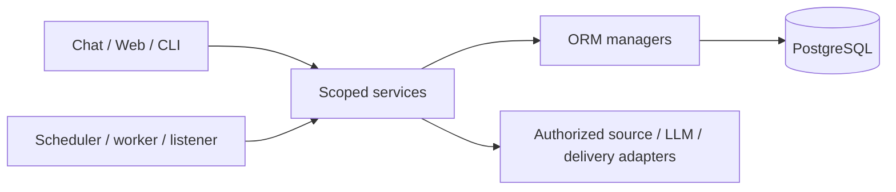

# Code map

Optional navigation when locating implementation. Product proposals belong in
[PRODUCT_PLAN](PRODUCT_PLAN.md); source-specific contracts are linked below.
This map is not deployment or acceptance evidence.

| Responsibility | Start in | Contract |
| --- | --- | --- |
| Combined runtime / worker | `app/runtime.py`, `app/worker.py` | [Jobs/schedules](AGENT_TASKS.md) |
| HTTP/web/admin | `app/main.py`, `app/api/`, `app/web/`, `app/admin/` | [API](API.md), [Admin](ADMIN.md) |
| Chat tools, sessions, memory | `app/agent/` | [Agent](AGENT.md) |
| Schedule and queue handlers | `app/tasks/`, `app/jobs/` | [Jobs/schedules](AGENT_TASKS.md) |
| Messenger transports | `app/channels/` | [Channels](CHANNELS.md) |
| Source credentials/collection | `app/services/social/`, `app/services/monitoring/` | [Collection](COLLECTION.md) |
| Structured analysis / LLM clients | `app/services/ai/` | [AI pipeline](AI_PIPELINE_AND_PROMPTS.md) |
| Digests / notifications | `app/services/digest/`, `app/services/notifications/` | [Digest](DIGEST.md), [Notifications](NOTIFICATIONS.md) |
| Tenant/security/configuration | `app/services/tenancy/`, `app/core/` | [Tenancy](TENANCY.md), [Configuration](CONFIGURATION.md) |
| ORM / managers / schemas | `app/models/`, `app/schemas/` | [Models](MODELS.md) |
| Operator commands / setup | `cli/`, `scripts/` | [CLI](CLI.md) |
| Migrations / regression suites | `migrations/`, `tests/` | [Deployment](DEPLOYMENT.md), [test contract](../tests/AGENTS.md) |

Frozen legacy: `app/celery/` and Streamlit. Work through existing managers/services;
the diagram describes responsibilities, not every import or authorization check.
